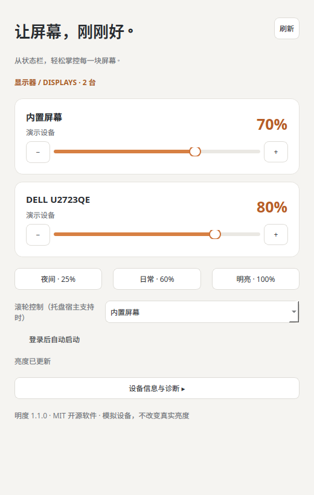

# Mingdu · 明度

[中文](README.md) · [Contributing](CONTRIBUTING.md) · [Validation](TESTING.md)

An open-source hardware brightness controller with a system tray menu, per-monitor sliders, presets and login startup.



**Version 1.1 is a development release. Windows and macOS backends are experimental. Mocked tests and successful packaging do not establish real-monitor compatibility. The UI currently uses Chinese labels.**

## Platforms

| Platform | Frontend | Hardware backend |
|---|---|---|
| Ubuntu 22.04 / 24.04 / 26.04 | Qt or GTK | logind/sysfs; ddcutil for DDC/CI |
| Windows 10 / 11 x64 | Qt tray | DXVA2 DDC/CI; WMI backlight via system PowerShell |
| macOS Apple Silicon | Qt menu bar | m1ddc; brightness for Apple/native backlights |
| macOS Intel | Qt menu bar | ddcctl; brightness for Apple/native backlights |

Source installs require Python 3.10+. macOS CI bundles target macOS 15+ with separate arm64/Intel builds; use native-architecture Python. Earlier macOS versions may work with an appropriate Qt release but are not validated.

## Source installation

```sh
git clone https://github.com/ZhaoOyu/mingdu.git
cd mingdu
python3 -m venv .venv
.venv/bin/python -m pip install ".[qt]"
.venv/bin/python -m brightness --ui qt
```

On Windows use `py -3 -m venv .venv` and `.venv\Scripts\python.exe` instead. No administrator privileges or external DDC utility are required on Windows. System policy may restrict PowerShell/WMI.

Ubuntu needs `ddcutil` for external monitors and an enabled GNOME AppIndicator extension. Qt/X11 may need `libxcb-cursor0`. The small GTK deb installs dependencies using `sudo apt install ./mingdu_1.1.0_all.deb` without pip.

Install macOS helpers separately:

```sh
brew install brightness # Apple/native backlights
brew install m1ddc      # Apple Silicon external DDC/CI
# Intel Mac: brew install ddcctl
```

Finder-launched apps also search `/opt/homebrew/bin` and `/usr/local/bin`. Helpers are not bundled. Ports, docks, DisplayLink, HDR and firmware can limit support.

## Development builds

Successful [GitHub Actions runs](https://github.com/ZhaoOyu/mingdu/actions) upload native archives and SHA-256 files for 14 days. Downloading workflow artifacts requires login.

- Windows: extract the whole ZIP and run `Mingdu/Mingdu.exe`.
- macOS: extract the matching architecture and move `Mingdu.app` to Applications; install helpers separately.
- Linux: extract tar.gz and run `Mingdu/Mingdu`; hardware helpers remain external.

These are unsigned development builds without Apple Developer ID notarization or Windows code signing. Security policies may prevent execution. Use source installation or your organization's normal approval process; do not disable system protections.

## Behavior

- Per-monitor and all-monitor tray commands, with continuous sliders in a separate panel.
- Wheel events work only when forwarded by the tray host. Qt does not guarantee Windows/macOS tray scrolling.
- Serial background hardware access; rapid requests coalesce per monitor; failed writes revert to confirmed values.
- Startup reads current settings without changing them. Range: 1–100%, no gamma or overlay dimming; existing 0% is reported accurately.
- Refresh after hotplug, wake or external changes. No periodic polling.
- Closing the panel keeps the tray running if a host exists. Use Quit to exit.
- Enable login startup after moving the app to its final location. GTK and Qt should not run concurrently.

Only brightness is exposed in this release. Contrast, volume and input switching are future capability-driven features.

```sh
python -m brightness --demo --ui qt # simulated devices, no physical writes
python -m brightness --diagnose    # read-only JSON, exit 1 if no devices
python -m brightness --background
python -m brightness --ui gtk      # Linux system Python + GI required
```

Enable DDC/CI in your monitor OSD. Report unsupported devices with OS, model, port and helper version, removing serial numbers and personal paths from diagnostics. Mingdu has no telemetry.

## Build and test

```sh
python -m pip install -e ".[qt,build]" ruff
python -m unittest discover -s tests -v
python tests/qt_smoke.py
python -m ruff check .
python -m build
python tools/build_desktop.py
```

Build on each target OS/architecture: PyInstaller does not cross-compile. GitHub Actions covers Linux, Windows and both macOS architectures with mocked monitors; GTK has a separate Ubuntu job. See [TESTING.md](TESTING.md) for limits and manual validation.

Settings: `~/.config/mingdu`, `%APPDATA%\mingdu`, or `~/Library/Application Support/mingdu`. Startup uses XDG autostart, HKCU Run, or LaunchAgents. Disable it before uninstalling. Ubuntu user installs support `./install.sh --uninstall`; deb uses `sudo apt remove mingdu`. Frozen apps can be removed by deleting their directory/bundle. Personal settings are retained.

## License

Mingdu is [MIT](LICENSE). Dependencies retain their licenses; see [third-party notices](THIRD_PARTY_NOTICES.md). Contributions and hardware compatibility reports are welcome.
