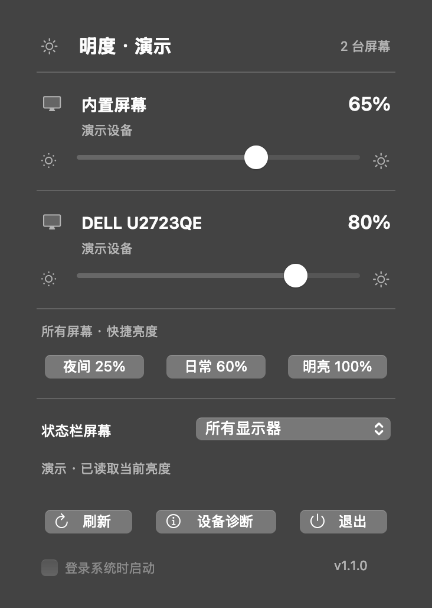
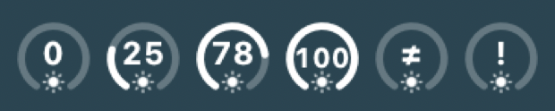

# Mingdu · 明度

**See your brightness. Find your comfortable light.**

Brighten your external monitor by day, soften your laptop screen at night. Mingdu puts each display's brightness in your menu bar: open, slide, and carry on—without reaching behind your monitor.

Free, open source, and local. Available for **macOS, Windows, and Ubuntu**.

[Download](#download) · [Installation guide](docs/INSTALL.md#english-quick-start) · [Report an issue](https://github.com/ZhaoOyu/mingdu/issues) · [简体中文](README.md)

> **1.2.0 Preview 1 brings a native Mac panel and a sun-shaped brightness ring.** Mac helpers are bundled—no Homebrew needed. Windows and Ubuntu share the refreshed compact layout.

<picture><source media="(prefers-color-scheme: dark)" srcset="docs/preview-dark.png"></picture>

Native control preview with simulated monitors. System translucency and shadows appear in the running app. The UI is Chinese. <a href="docs/preview-gtk.png">Ubuntu preview</a>

## Small conveniences, every day

- **Feels at home on your Mac.** A native menu bar popover with system icons, translucent material and automatic light/dark appearance.
- **Brightness at a glance.** An upper progress arc, a bold number and a sun below form the tray indicator. Choose the display to track; readings reflect confirmed hardware values.
- **A comfortable setting for every screen.** Adjust built-in and external monitors independently, or change them together.
- **One-click lighting presets.** Night 25%, Everyday 60%, and Bright 100% apply to all displays.
- **Ready after installation on Mac.** Brightness helpers ship inside the app. No Homebrew or first-launch downloads. External monitors must still support and enable DDC/CI.
- **Keeps your existing settings.** Startup only reads brightness. Login startup is optional. Failed changes show an error and return the displayed value to its last confirmed reading.
- **Your display information stays local.** No account, telemetry, or uploads.

Mingdu controls system backlights and monitor hardware brightness rather than placing a dark overlay on your screen.

## Download

**Current version: 1.2.0 Preview 1**, including the redesigned interface and sun-shaped brightness ring shown above. Try it and share your display compatibility feedback.

| System | Download | Installation |
|---|---|---|
| macOS 15+ · Apple Silicon | [arm64 DMG](https://github.com/ZhaoOyu/mingdu/releases/download/v1.2.0-preview.1/mingdu-1.2.0-macos-arm64.dmg) | Drag to Applications; helpers are included |
| macOS 15+ · Intel | [Intel DMG](https://github.com/ZhaoOyu/mingdu/releases/download/v1.2.0-preview.1/mingdu-1.2.0-macos-x86_64.dmg) | Drag to Applications; helpers are included |
| Windows 10 / 11 · x64 | [Installer](https://github.com/ZhaoOyu/mingdu/releases/download/v1.2.0-preview.1/mingdu-1.2.0-windows-x86_64-setup.exe) | Double-click; no separate Python installation |
| Ubuntu 22.04 / 24.04 / 26.04 | [DEB package](https://github.com/ZhaoOyu/mingdu/releases/download/v1.2.0-preview.1/mingdu_1.2.0_all.deb) | Install using apt to resolve system dependencies |

[All downloads and checksums](https://github.com/ZhaoOyu/mingdu/releases) · [Installation instructions](docs/INSTALL.md)

Mac and Windows previews do not yet have trusted signing or Apple notarization. See the installation guide for first-launch system prompts.

## Find your comfortable setting

1. Launch Mingdu and open its menu bar or tray panel.
2. Drag a display's slider, or choose a preset. Presets change **all displays**.
3. Select the screen to follow in the tray. Refresh after reconnecting displays, waking the computer or changing brightness elsewhere.

Enable login startup if you want Mingdu ready each day.

| Ring display | Meaning |
|---|---|
| Number | Confirmed brightness percentage; the percent sign is omitted |
| `≠` | All displays are selected, but their brightness differs |
| `!` | A selected display failed to change; open diagnostics |
| `--` | No usable brightness reading yet |

## Will my display work?

Built-in displays need a supported backlight interface. External monitors need **DDC/CI**, usually enabled in the monitor's own menu. HDR modes, docks, KVMs, adapters and DisplayLink can affect compatibility.

An Apple backlight screen and Kuycon G27-X have passed local write, readback and restoration checks. Other equipment still needs real-device validation; the new native interface also has simulated-device interaction tests. See [validation details](TESTING.md).

Mingdu currently focuses on brightness. If a screen is missing or cannot be adjusted, open device diagnostics and consult the [installation guide](docs/INSTALL.md), or [share a compatibility report](https://github.com/ZhaoOyu/mingdu/issues/new/choose).

## Help more screens feel right

Share your OS, monitor model and connection details, or contribute code, documentation and translations.

[Contributing](CONTRIBUTING.md) · [Changelog](CHANGELOG.md) · [Security](SECURITY.md)

Mingdu is [MIT licensed](LICENSE). Dependencies retain their own licenses; see [third-party notices](THIRD_PARTY_NOTICES.md).
