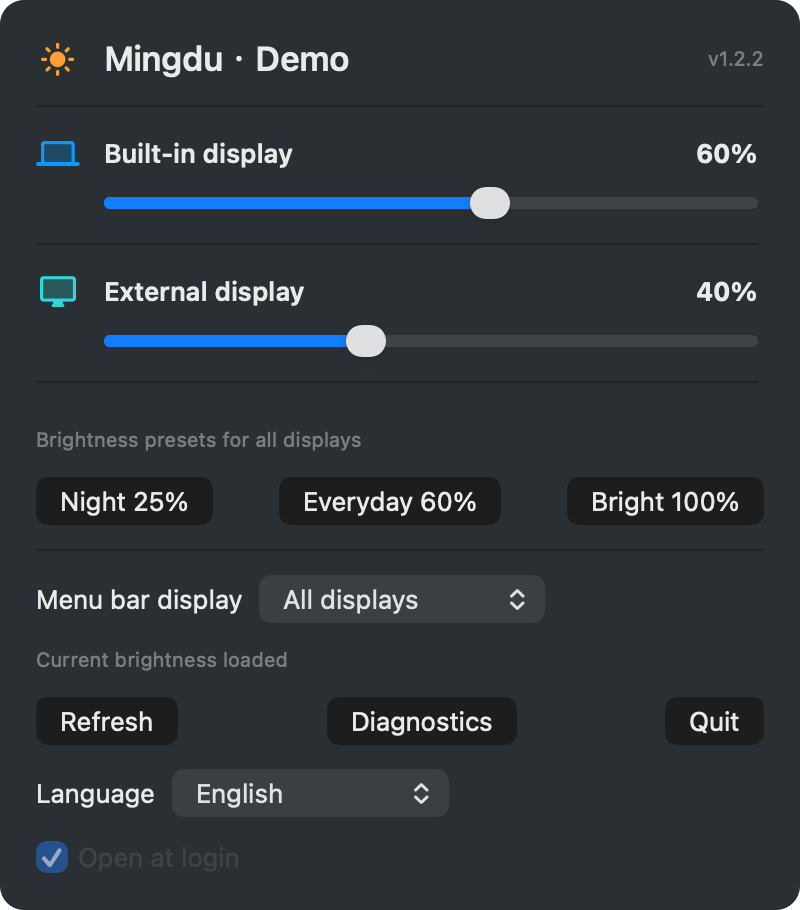

# Mingdu · 明度

Turn down your external monitor while leaving your laptop screen just as it is. Open Mingdu from the menu bar or system tray and drag the slider for the display you want to adjust.

**[Download the 1.2.2 preview](#download)** · [简体中文](README.md)

The number above the sun is the brightness percentage. The arc fills as the screen gets brighter.

- **Fine-tune one screen.** On Mac, drag to any whole percentage from 1% to 100%. Focus the slider and use the arrow keys for 1% adjustments.
- **Set every screen at once.** Choose Night (25%), Everyday (60%), or Bright (100%) to apply the preset to all supported displays.
- **Keep a brightness reading in the menu bar.** The sun ring shows the confirmed brightness of your chosen display. When you select all displays, ≠ means their levels differ.

## Download

- [macOS 15 or later · Apple Silicon](https://github.com/ZhaoOyu/mingdu/releases/download/v1.2.2-preview.1/mingdu-1.2.2-macos-arm64.dmg)
- [macOS 15 or later · Intel](https://github.com/ZhaoOyu/mingdu/releases/download/v1.2.2-preview.1/mingdu-1.2.2-macos-x86_64.dmg)
- [Windows 10 or 11 · x64](https://github.com/ZhaoOyu/mingdu/releases/download/v1.2.2-preview.1/mingdu-1.2.2-windows-x86_64-setup.exe)
- [Ubuntu 22.04, 24.04 or 26.04](https://github.com/ZhaoOyu/mingdu/releases/download/v1.2.2-preview.1/mingdu_1.2.2_all.deb)

On Mac, open the DMG and drag Mingdu into Applications. The display tools are included. For an external monitor, enable **DDC/CI** in its on-screen menu. Click Refresh (刷新) after reconnecting a display.

[Installation guide](docs/INSTALL.md#english-quick-start) · [Report a display compatibility issue](https://github.com/ZhaoOyu/mingdu/issues)

The interface follows your system language by default. Open **Language** at the bottom of the panel to switch to **简体中文** or **English**.
