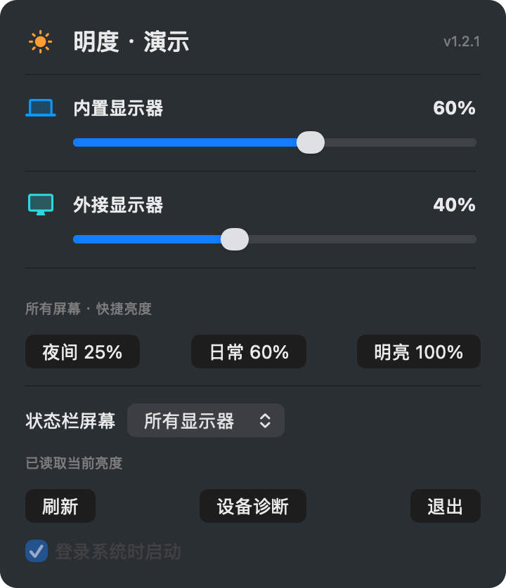

# 明度

外接屏太亮，笔记本屏幕却刚刚好？从菜单栏点开明度，每块屏幕都有自己的亮度条。只拖动想调的那一块就行，不用伸手找显示器背后的按钮。

**[下载明度 1.2.1 预览版](#下载)** · [English](README.en.md)

- **单独调一块屏幕。** Mac 上可以拖动滑块选取 1% 到 100% 的亮度。选中滑块后，按左右方向键，每次微调 1%。
- **一键调好所有屏幕。** 夜间 25%、日常 60%、明亮 100%，三个预设会同时应用到所有可调节的屏幕。
- **收起后也看得到亮度。** 菜单栏的太阳圆环显示所选屏幕已确认的亮度。选「所有显示器」时，如果各屏亮度不同，会显示 ≠。

## 下载

| 你的电脑 | 安装包 |
| --- | --- |
| macOS 15 及以上 · M 系列芯片 | [下载 Mac 版](https://github.com/ZhaoOyu/mingdu/releases/download/v1.2.1-preview.1/mingdu-1.2.1-macos-arm64.dmg) |
| macOS 15 及以上 · Intel 芯片 | [下载 Intel Mac 版](https://github.com/ZhaoOyu/mingdu/releases/download/v1.2.1-preview.1/mingdu-1.2.1-macos-x86_64.dmg) |
| Windows 10 / 11 · 64 位 | [下载 Windows 版](https://github.com/ZhaoOyu/mingdu/releases/download/v1.2.1-preview.1/mingdu-1.2.1-windows-x86_64-setup.exe) |
| Ubuntu 22.04 / 24.04 / 26.04 | [下载 Ubuntu 安装包](https://github.com/ZhaoOyu/mingdu/releases/download/v1.2.1-preview.1/mingdu_1.2.1_all.deb) |

Mac 用户打开 DMG，将 Mingdu 拖入「应用程序」即可，亮度辅助工具已随包提供。调节外接屏幕时，请在显示器自身的菜单里开启 **DDC/CI**。重新连接屏幕后，点「刷新」即可重新检测。

[安装与常见问题](docs/INSTALL.md) · [反馈显示器兼容性](https://github.com/ZhaoOyu/mingdu/issues)
